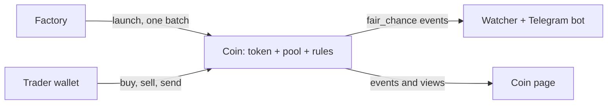

# Fair Chance

**You buy. The creator dumps on you. You hold the bag.**

Fair Chance is a memecoin launchpad on NEAR where that story needs a different ending. Every coin it launches has sell limits written into the coin contract. The creator, early buyers and large holders can sell into the pool at the pace the pool's depth allows, and no faster. A large holder cannot split a bag by sending it to other wallets.

Built for NEAR HACKATHON, track Memecoins With Mechanics. Coin interface 1.0.0-rc.5 (the version becomes 1.0.0 when every rule passes its sandbox tests).

<!-- waits on: the testnet deploy (links row: live page, demo video with its length, "no login, no key") -->

The whole supply is minted once at launch, and no burn method exists. The rules slow a dump. They do not stop it. See [Known limits](#known-limits).

## Try it in 90 seconds

You need the tools below. `verify.sh doctor` checks every pin and starts nothing.

- Rust 1.97.1 with the `wasm32-unknown-unknown` target (`rust-toolchain.toml` sets both)
- `cargo-near` 0.21.1, Go 1.26, Node 24.13.1 (`web/.nvmrc`), Google Chrome
- A `near-sandbox` 2.13.4 binary, with `NEAR_SANDBOX_BIN_PATH` pointing at it

1. Check the tools.

   ```sh
   .claude/skills/verify/verify.sh doctor
   ```

   You see one `doctor: ok` line per tool and then `verify: PASS (doctor)`.

2. Launch a coin on a fresh sandbox, buy, sell, and read the receipt.

   ```sh
   scripts/walking-path.sh
   ```

   The script builds the contracts, starts a sandbox, launches one coin through the factory, buys, sells half, and prints the `fc_sell` receipt with the interface field names. The Go watcher then reads the same receipt and sends one alert to a fake sender. The script exits 0 when every step passes, and non-zero when any step fails.

3. See a sell refused in part on purpose.

   ```sh
   cargo test --locked -p fair-chance-rule-engine --test partial_fill_and_band_penalty \
     a_large_sell_above_its_allowance_fills_the_allowance_left_and_the_rest_stays_in_the_wallet
   ```

   The test passes. A large holder asks to sell more than one allowance. The coin fills the allowance, and the rest stays in the wallet.

<!-- waits on: the judge-path script (one command that launches a coin, buys, sells above the allowance, shows the partial fill and its receipt on the coin page, and shows a refused send) -->

## For judges

The hackathon FAQ names how projects are judged: Claude Code and Codex screen each project by checking that it runs and does what the README says. Human judges then decide. The FAQ also lists the criteria earlier NEAR hackathons used. The track prompt says "Judged on the mechanic, not the chart." Sources: [nearhackathon.com](https://nearhackathon.com), [HACKATHON.md](https://nearhackathon.com/HACKATHON.md). The track's example prompt is linked from HACKATHON.md.

| What is judged | Where you see it |
| --- | --- |
| Technical implementation | The rules run in the coin contract. Run step 2, then `cargo test --workspace --locked` ([evidence](docs/evidence.md)). |
| Design | The coin page shows limits, receipts and refusals in plain words (`web/`). <!-- waits on: the page link and screenshots --> |
| Impact | The problem is in [OVERVIEW](docs/OVERVIEW.md). Demand is not measured, and the numbers are a replay and a simulation ([measured results](#measured-results)). |
| Originality | [Differences from a per-sell cap](#how-this-differs-from-a-per-sell-cap) and [credits](#libraries-templates-and-ai-tools). The falling early fee is not new ([ADR 0008](docs/adr/0008-snipers-are-early-supply-with-early-fee.md)). |
| Sustainability | The creator earns a fee share after the pool holds depth for 24 hours ([ADR 0010](docs/adr/0010-creator-fee-share-after-24h-depth.md)). |
| The mechanic, not the chart | Sell limits, partial fills and the real NEAR cap sit in `rule-engine/` and `contracts/coin/`. No price chart is a rule. |
| Mechanic in the contract, not a backend | One contract holds the token and the pool ([ADR 0002](docs/adr/0002-token-and-pool-in-one-contract.md)). The watcher and the page read and explain. They hold no rule. |
| Parameters set at launch, no admin key | The coin account has no access keys, and every value is a constant read with `fc_rules` ([ADR 0006](docs/adr/0006-zero-keys-global-contract-by-hash.md)). |
| Sybil limits written plainly | [Known limits](#known-limits) and [evidence](docs/evidence.md). |
| A page with live state and a log | The coin page shows state and one receipt row per sell. <!-- waits on: the judge-path script and the testnet deploy --> |
| A 60-day simulation under a few scenarios | [analysis/FINDINGS.md](analysis/FINDINGS.md) |

<!-- waits on: the merge of the replay and simulation branch (analysis/FINDINGS.md does not exist on this branch yet) -->

## The rules

Values are the fixed constants in `rule-engine/src/fixed_values.rs`. Every coin gets the same ones. Some values are not final ([ADR status lines](docs/adr/)).

| Rule | What it means for a trader |
| --- | --- |
| Window | Allowances reset on a fixed grid from launch: 1 hour for ordinary accounts, 24 hours for early supply ([glossary](GLOSSARY.md)). |
| Allowance | Each account may sell up to one allowance per window. The allowance is sized by pool depth: a 2% price drop at most (`p_bps` 200) ([ADR 0001](docs/adr/0001-large-holders-cannot-send-shared-early-allowance.md)). |
| Small bag | <!-- waits on: the marked-token cap rule (the wording for bags inside one allowance and the floor) --> |
| Class | Small, band or large. Large starts at 2% of supply. Class never drops below its level just before your opening action in the window, so selling in parts pays the same as one sell ([ADR 0001](docs/adr/0001-large-holders-cannot-send-shared-early-allowance.md), `rule-engine/src/holder_class.rs`). |
| Large holders | A large account cannot send tokens. A send that would make a receiver large is refused. A buy is the one way an account becomes large. <!-- waits on: the rewritten wording for the large-at-zero class exception --> |
| Partial fill | A large or early-supply sell above the allowance fills in part. The rest stays in the wallet ([ADR 0004](docs/adr/0004-partial-fill-band-penalty-per-class-windows.md)). |
| Band penalty | A band account may sell above one allowance and pays 10% on the NEAR of the part above. The penalty stays in the pool. <!-- waits on: the rewritten wording for the allowance and cap sentence --> |
| Real NEAR cap | <!-- waits on: the marked-token cap rule (how one cap limits all real NEAR paid out per window) --> See [ADR 0005](docs/adr/0005-live-pool-wide-cap-on-real-near.md). |
| Early window | A buy in blocks 0 to N (N is 17) is early supply and cannot sell in those blocks. Early supply shares one allowance per 24 hours ([ADR 0008](docs/adr/0008-snipers-are-early-supply-with-early-fee.md)). |
| Early fee | The buy fee starts at 50% and falls to 1% over blocks 0 to 17. It goes to the pool and no account is exempt. The falling fee is not new. |
| Creator cap | The creator group may hold at most 4% of supply ([ADR 0003](docs/adr/0003-virtual-reserve-no-graduation.md)). |
| Creator fee | The creator earns 30% of the normal 1% swap fee. A claim pays after the pool holds 10 real NEAR for 24 hours ([ADR 0010](docs/adr/0010-creator-fee-share-after-24h-depth.md)). |
| Sell needs 1 yoctoNEAR | A leaked app login key cannot sell ([ADR 0009](docs/adr/0009-one-yocto-on-sell.md)). |
| Opening buy | `buy` refuses an account with no storage record. Call `storage_deposit` before it, or send both calls in one transaction. |

## How this differs from a per-sell cap

- The limits follow pool depth, not a fixed share per sell ([ADR 0001](docs/adr/0001-large-holders-cannot-send-shared-early-allowance.md)).
- A limited sell fills in part. It does not fail ([ADR 0004](docs/adr/0004-partial-fill-band-penalty-per-class-windows.md), `partial_fill_and_band_penalty` tests).
- A large holder cannot split a bag by sends: large accounts cannot send, and a send cannot make a receiver large (`holder_class_and_sends` tests).
- The creator group shares one limit, and so does all early supply ([ADR 0001](docs/adr/0001-large-holders-cannot-send-shared-early-allowance.md)).
- One cap limits all real NEAR paid out per window ([ADR 0005](docs/adr/0005-live-pool-wide-cap-on-real-near.md), `real_near_cap` tests).

In facts, against [meme.cooking](https://docs.meme.cooking/): its docs describe an auction where every depositor buys at the same price, then a pool on Ref Finance with locked LP shares. Fair Chance has no auction and no outside pool. The coin holds its own pool, and sells face the limits above.

## What the contract enforces, and what the page merely shows

| Part | Role | Can it move funds or change a limit? |
| --- | --- | --- |
| Coin contract | Token, pool and every rule. Hard refusals return an `FC_` code. | Yes. It is the rule. |
| Factory | Launches each coin in one batch with no key. | Calls `new` once. No coin method gives it a special right. |
| Coin page | Reads state and events, explains limits and refusals. | No. |
| Watcher and Telegram bot | Read events, send alerts to the builder's private chat. | No. |

Nobody can change a coin after launch. These three lines are the claim ([ADR 0006](docs/adr/0006-zero-keys-global-contract-by-hash.md)):

- The coin account has no access keys.
- Its code is a global contract used by a stated code hash.
- The contract has no owner, pause, setter or upgrade method (`coin_method_list` test).



## Network

<!-- waits on: the testnet deploy (factory account, coin code hash, deployed commit, explorer links) -->

<!-- waits on: the reproducible build (the code-hash line and the check-it-yourself command) -->

## Check it yourself

```sh
cargo test --workspace --locked      # rule tests, property tests, sandbox tests
.claude/skills/verify/verify.sh      # the merge gate: sandbox walking path, page in Chrome, private-string scan
```

Open `docs/evidence.md` for what each test proves. Sandbox tests need `NEAR_SANDBOX_BIN_PATH` and a built wasm (`scripts/build-contracts.sh`).

## Measured results

These are recorded runs, not guarantees.

| What | Result | Conditions |
| --- | --- | --- |
| Rule tests | <!-- waits on: the final test count --> | `cargo test --workspace --locked` |
| Property tests | Two real NEAR cap properties run 10,000 random cases per run. | Random multi-account sequences. The regression file is committed. |
| NEAR launch replay and 60-day simulation | See [analysis/FINDINGS.md](analysis/FINDINGS.md). | Public-chain replay and synthetic activity. Not a forecast. |
| SMDD replay | <!-- waits on: the SMDD replay section --> | |

Numbers from a replay or a simulation show how the rules behave. They are simulation, not demand.

## Known limits

The rule slows a dump. Each line below is a way around it or a cost it leaves. Details and tests are in [docs/evidence.md](docs/evidence.md) and [OVERVIEW](docs/OVERVIEW.md).

- Wallet splitting. A fresh account still gets a fresh allowance. A bag split into many small wallets, each inside one allowance, sells with no limit.
- Creator-funded wallets. The contract cannot see who funded an account. A wallet the creator funds that buys after block N is unmarked.
- Late splitters. People who buy after block N through many small wallets at market price skip the early-supply rules.
- Floors above the cap. Each account has its own floor, so many accounts can pass a full cap.
- Bots at the reset. Every allowance and the cap reset at the same moment.
- Aggregators and routers cannot buy for users, because the caller holds the tokens.
- Account handover. A holder can give away a whole account, keys included.
- Plain `storage_unregister` differs from NEP-145 in two ways. It refuses while the window is open (`FC_UNREGISTER_WINDOW_OPEN`), and it refuses an account with tokens with `FC_UNREGISTER_WITH_BALANCE`.
- Testnet tokens have no value. Screens marked "sample data" show no real trades.

<!-- waits on: the SMDD replay section -->

## Libraries, templates and AI tools

- Claude Code wrote most of the code and the docs, under the builder's direction.
- Contracts: `near-sdk`, `cargo-near`. Tests: `near-sandbox`, `near-api`, `proptest`, `tokio`.
- Watcher: Go. Page: TypeScript, Vite, Vitest, Playwright core for browser checks.
- Prior curve designs: the constant-product pool with a virtual reserve comes from earlier launchpad curves ([ADR 0002](docs/adr/0002-token-and-pool-in-one-contract.md), [ADR 0003](docs/adr/0003-virtual-reserve-no-graduation.md)). No code is copied from other launchpads.
- The launch replay and the simulation come from Kalu ([analysis/FINDINGS.md](analysis/FINDINGS.md)).
- Code written before 1 November 2026: <!-- waits on: the baseline tag list -->

## Layout

`rule-engine/` holds the rules as plain Rust. `contracts/coin/` and `contracts/factory/` wrap them. `sandbox-tests/` runs them on a local chain. `watcher/` is the Go alert service. `web/` is the coin page. `docs/` holds [OVERVIEW](docs/OVERVIEW.md), [INTERFACE](docs/INTERFACE.md), the [ADRs](docs/adr/) and [GLOSSARY](GLOSSARY.md).

## License

MIT. See [LICENSE](LICENSE).
