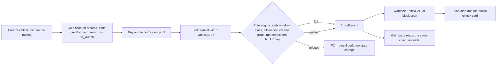
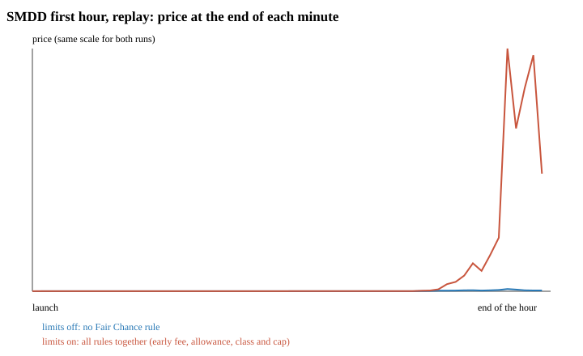

# Fair Chance

**You buy. The cabal dumps on you. You're left holding the bag.**

The coin cannot know who is in a cabal, so it gives a tighter limit to whoever bought in the first blocks.

Fair Chance slows the dump at launch, inside the coin contract.

Fair Chance is a memecoin launchpad on NEAR where that story needs a different ending. Every coin it launches has sell limits written into the coin contract. The creator, early buyers and large holders can sell into the pool at the pace the pool's depth allows, and no faster. A large holder cannot split a bag by sending it to other wallets.

Built for NEAR HACKATHON, track Memecoins With Mechanics. Coin interface 1.0.0-rc.7 (the version becomes 1.0.0 when every rule passes its sandbox tests).

<!-- waits on: the testnet deploy (links row: live page, demo video with its length, "no login, no key") -->

The whole supply is minted once at launch, and no burn method exists. The rules slow a dump. They do not stop it. See [Known limits](#known-limits).

## Contents

- [The problem](#the-problem)
- [What it does](#what-it-does)
- [Try it in 90 seconds](#try-it-in-90-seconds)
- [Run the sniper scene yourself](#run-the-sniper-scene-yourself)
- [For judges](#for-judges)
- [How it works](#how-it-works)
- [Architecture](#architecture)
- [The rules](#the-rules)
- [How this differs from a per-sell cap](#how-this-differs-from-a-per-sell-cap)
- [Network](#network)
- [Check it yourself](#check-it-yourself)
- [Check it from a terminal](#check-it-from-a-terminal)
- [Measured results](#measured-results)
- [Known limits](#known-limits)
- [Not in this release](#not-in-this-release)
- [Libraries, templates and AI tools](#libraries-templates-and-ai-tools)
- [Layout](#layout)
- [License](#license)

Deeper pages: [evidence](docs/evidence.md), [TLA+ model](docs/model/README.md), [OVERVIEW](docs/OVERVIEW.md), [INTERFACE](docs/INTERFACE.md), [GLOSSARY](GLOSSARY.md), [ADRs](docs/adr/).

## The problem

A new memecoin launches, and in the first minutes the creator and a few large wallets sell into the pool. Later buyers take the loss. Tools that warn a buyer act after the damage. A high fee on early buys is paid once, and it does not limit the later sells. [OVERVIEW](docs/OVERVIEW.md) has the full case.

## What it does

The sell limits live in the coin contract, so no off-chain part can lift them. Each coin has its own pool and the same fixed rules. A sell above a limit fills in part, and the rest stays in the wallet. [The rules](#the-rules) lists each rule with its decision record. [How it works](#how-it-works) follows one coin from launch to alert.

## Try it in 90 seconds

You need the tools below. `verify.sh doctor` checks every pin and starts nothing.

- Rust 1.97.1 with the `wasm32-unknown-unknown` target (`rust-toolchain.toml` sets both)
- `cargo-near` 0.21.1, Go 1.26, Node 24.13.1 (`web/.nvmrc`), Google Chrome
- A `near-sandbox` 2.13.4 binary, with `NEAR_SANDBOX_BIN_PATH` pointing at it

1. Check the tools.

   ```sh
   .claude/skills/verify/verify.sh doctor
   ```

   You see one `doctor: ok` line per tool and then `verify: PASS (doctor)`.

2. Launch a coin on a fresh sandbox, buy, sell, and read the receipt.

   ```sh
   scripts/walking-path.sh
   ```

   The script builds the contracts, starts a sandbox, launches one coin through the factory, buys, sells half, and prints the `fc_sell` receipt with the interface field names. The Go watcher then reads the same receipt and sends one alert to a fake sender. The script exits 0 when every step passes, and non-zero when any step fails.

3. See a sell refused in part on purpose.

   ```sh
   cargo test --locked -p fair-chance-rule-engine --test partial_fill_and_band_penalty \
     a_large_sell_above_its_allowance_fills_the_allowance_left_and_the_rest_stays_in_the_wallet
   ```

   The test passes. A large holder asks to sell more than one allowance. The coin fills the allowance, and the rest stays in the wallet.

4. Run the whole judge path in one command.

   ```sh
   scripts/judge-path.sh
   ```

   The script launches the demo coin on a fresh sandbox and refuses an opening buy above 4% and an early-window sell. It then buys a large bag, refuses a send, fills a sell in part, and fills a sell up to the real NEAR cap. It shows the receipt on the coin page in headless Chrome and sends the watcher alerts to a fake sender. It prints one `PASS` line per check and exits 0. The first failed check prints a `FAIL` line and exits 1. It needs `NEAR_SANDBOX_BIN_PATH`.

## Run the sniper scene yourself

One command plays a sniper cabal on a fresh local sandbox and prints its numbers:

```sh
scripts/sniper-scene.sh
```

It takes about 3 minutes plus the first build. It needs `near-sandbox` 2.13.4 (`NEAR_SANDBOX_BIN_PATH`), `cargo-near` 0.21.1 and python3. Google Chrome makes the PNG charts (`FC_BROWSER_PATH` overrides the binary). Without Chrome you get the SVG charts only. It uses throwaway sandbox keys and never touches testnet.

What happens, with the fixed rules:

1. The creator launches a coin with an opening buy.
2. A funder makes 10 sniper wallets. They buy together in the first blocks, so all their tokens are early supply.
3. Each sniper tries to sell its whole bag inside the early window (blocks 0 to 17). Every sell is refused with `FC_EARLY_WINDOW`.
4. After the window, 3 ordinary buyers buy a small bag each. Then the snipers sell their whole bags, and then the buyers sell theirs.
5. Last, the creator sells its whole bag. The snipers and the creator share one allowance, so the shared allowance left ends at 0.

The result of two clean runs, with the same numbers in both (group totals):

- Early-window sells: all refused with `FC_EARLY_WINDOW` (FROM CHAIN).
- The snipers' asked tokens that went through: 3.9% with Fair Chance (FROM CHAIN), all of them without (CALCULATED).
- The pool's real NEAR the snipers took: 2.9% with Fair Chance (FROM CHAIN), 60% without (CALCULATED).
- Price drop from the snipers' sells: 1.66% with Fair Chance (FROM CHAIN), 32.02% without (CALCULATED).
- The ordinary buyers' sells: filled in full (FROM CHAIN).
- The shared allowance left after the creator's sell: 0, except for rounding dust (FROM CHAIN).

The script writes `summary.md`, `derived.json`, `run.json` and the two charts to `target/sniper-scene/<run id>/`. FROM CHAIN means read from the sandbox receipts and views. CALCULATED means a plain pool with the same fee, the same start and the same order, with no Fair Chance limit ([analysis/sniper-scene/analyze.py](analysis/sniper-scene/analyze.py)). Each sell matches `fc_quote_sell` read just before it, and a replay of the sniper receipts gives the chain's pool exactly. If an early sell lands after block 17, the script prints `FAIL` and no numbers.

Conditions:

- The shared allowance refills every 24 h. It slows the dump. It does not stop it forever.
- It binds before the 5% real NEAR cap only when the pool's real NEAR is above about a quarter of its virtual NEAR.
- The ordinary buyers' full fill is a same-hour round trip. A buyer who sells in a later hour is limited by its own allowance.

### Two buys, the same size (local sandbox)

The scene ends with one more test on a second coin. Two accounts make the same buy: one in block 10 after launch, inside the early window, and one in block 23, after it. Both then sell their whole bag in the same hour as their buy.

- The early buy sold 16.3% of its bag. Its limit was the allowance. It also paid the early buy fee, so it got about 17.7% fewer tokens for the same NEAR.
- The late buy sold 100% of its bag, with no limit, because a round trip inside one hour fills in full.

So the quick flip is gone for the early buy. This is a local sandbox run, not testnet, and it says nothing about price. Command, commit and condition are in [`evidence/sniper-scene-local.md`](evidence/sniper-scene-local.md).

## For judges

The hackathon FAQ names how projects are judged: Claude Code and Codex screen each project by checking that it runs and does what the README says. Human judges then decide. The FAQ also lists the criteria earlier NEAR hackathons used. The track prompt says "Judged on the mechanic, not the chart." Sources: [nearhackathon.com](https://nearhackathon.com), [HACKATHON.md](https://nearhackathon.com/HACKATHON.md). The track's example prompt is linked from HACKATHON.md.

| What is judged | Where you see it |
| --- | --- |
| Technical implementation | The rules run in the coin contract. Run step 2, then `cargo test --workspace --locked` ([evidence](docs/evidence.md)). |
| Design | The coin page shows limits, receipts and refusals in plain words (`web/`). <!-- waits on: the page link and screenshots --> |
| Impact | The problem is in [OVERVIEW](docs/OVERVIEW.md). Demand is not measured, and the numbers are a replay and a simulation ([measured results](#measured-results)). |
| Originality | [Differences from a per-sell cap](#how-this-differs-from-a-per-sell-cap) and [credits](#libraries-templates-and-ai-tools). The falling early fee is not new ([ADR 0008](docs/adr/0008-snipers-are-early-supply-with-early-fee.md#decision)). |
| Sustainability | The creator earns a fee share after the pool holds depth for 24 hours ([ADR 0010](docs/adr/0010-creator-fee-share-after-24h-depth.md#decision)). |
| The mechanic, not the chart | Sell limits, partial fills and the real NEAR cap sit in `rule-engine/` and `contracts/coin/`. No price chart is a rule. |
| Mechanic in the contract, not a backend | One contract holds the token and the pool ([ADR 0002](docs/adr/0002-token-and-pool-in-one-contract.md)). The watcher and the page read and explain. They hold no rule. |
| Parameters set at launch, no admin key | The coin account has no access keys, and every value is a constant read with `fc_rules` ([ADR 0006](docs/adr/0006-zero-keys-global-contract-by-hash.md)). |
| Sybil limits written plainly | [Known limits](#known-limits) and [evidence](docs/evidence.md). |
| A page with live state and a log | The coin page shows state and one receipt row per sell. <!-- waits on: the testnet deploy (a link to a coin page that shows live state) --> |
| A 60-day simulation under a few scenarios | [analysis/FINDINGS.md](analysis/FINDINGS.md) |

## How it works



1. **Launch.** A creator calls `launch` on the factory with a name, a ticker and an optional opening buy. The factory sends one batch: create the coin account, use the coin code by its hash, call `new`. The batch holds no key. An opening buy that takes the creator group above 4% of supply is refused with `FC_CREATOR_CAP`, and the whole batch rolls back and returns the deposit. After a good launch the factory logs `fc_launch`. Code: `contracts/factory/`. Check: the `fc_launch` event, and `fc_rules` on the coin.
2. **Buy.** `buy(min_tokens_out)` swaps NEAR for tokens on the coin's own constant-product pool, which has a virtual NEAR reserve. A buy in blocks 0 to N is early supply. It carries the falling early fee and is marked. A buy that takes an account to 2% of supply makes it large and logs `fc_became_large`. `FC_SLIPPAGE` refuses a buy below `min_tokens_out`. A buy is never filled in part. Code: `rule-engine/src/pool_math.rs`, `rule-engine/src/early_buy_fee.rs`. Check: `fc_quote_buy`, then the `fc_buy` event.
3. **Send.** A large account cannot send (`FC_LARGE_CANNOT_SEND`). A send that would make a receiver large is refused (`FC_RECEIVER_WOULD_BE_LARGE`), and so is a send into the coin (`FC_SEND_TO_COIN`) and `ft_transfer_call` (`FC_TRANSFER_CALL`). Marked tokens leave first. Code: `rule-engine/src/holder_class.rs`. Check: `fc_account` shows `can_send` and `max_receive`.
4. **Sell request.** `sell(amount, min_near_out)` needs exactly 1 yoctoNEAR (`FC_ONE_YOCTO`). Marked tokens cannot sell in blocks 0 to N (`FC_EARLY_WINDOW`). A sell is never refused for exceeding a limit. A limit gives a partial fill instead.
5. **Rule engine.** The engine reads the account's class (small, band or large, with the class floor), then fills as far as these limits allow: the allowance of the window (net of buys), the shared early-supply allowance for marked tokens, the pool-wide NEAR cap, and the floor that always fills. A band account that sells above its first allowance pays a 10% penalty that stays in the pool. Code: `rule-engine/src/actions.rs`, `allowance.rs`, `early_supply.rs`, `real_near_cap.rs`, `creator_group.rs`. Check: `fc_quote_sell` returns the same answer as the real sell, with no state change.
6. **The result.** The fill is `full`, `partial` or `none`. `FC_SLIPPAGE` refuses when the price per token of the filled part is below `min_near_out` (a partial fill does not fail slippage). The `limit_reason` says why a sell filled less: `allowance`, `cap_full` or `floor`. The coin logs `fc_sell`, and `fc_cap_filled` when the sell fills the cap. Check: the receipt on the coin page, or the event in the transaction on an explorer.
7. **Watch.** The watcher reads the coin's events with the FastNEAR transactions API on testnet, or by scanning blocks over plain NEAR RPC on a sandbox. It turns each limited-sell event into one plain sentence and sends it. It holds no NEAR key and signs nothing. The `/check` command reads the coin's views and writes a "who can sell now" card for any coin of the factory. Code: `watcher/internal/eventsource/`, `watcher/internal/alerts/`, `watcher/internal/checkcard/`.
8. **Read.** The coin page reads the same views and events from the chain. It needs no wallet, no login and no key. It cannot buy or sell. Code: `web/src/chain.ts`, `web/src/receipts.ts`.

When a step fails, the contract refuses with its code, and the call changes no state. Refusal texts are in `refusal-texts/`. The code list is in [INTERFACE](docs/INTERFACE.md).

## Architecture

| Part | Where it runs | What it does | Can it move funds or change a limit? |
| --- | --- | --- | --- |
| Factory (`contracts/factory/`) | NEAR, one account <!-- waits on: the testnet deploy (the factory account, and the line that says its keys are deleted) --> | Launches each coin in one batch and records the one coin code hash. | Calls `new` once. No coin method gives it a special right. |
| Coin (`contracts/coin/`) | NEAR, one account per coin, no access keys | Token, pool and every rule. Calls into `rule-engine/`. Hard refusals return an `FC_` code. | Yes. It is the rule. |
| Rule engine (`rule-engine/`) | Compiled into the coin; also run by tests as plain Rust | The rules as pure functions. | Only through the coin. |
| Coin page (`web/`) | Static files in a browser | Reads views and events from public RPC and shows limits, receipts and refusals. | No. |
| Watcher and bot (`watcher/`) | A Go process the builder runs | Reads events, sends alerts to the builder's private chat, answers `/check`. | No. |

There is no backend server. The rules run on chain. Each coin holds no key, and the factory holds none after its key is deleted <!-- waits on: the testnet deploy (the factory key deletion) -->. The page is static and only reads. The watcher and the page can go offline, and the coin still enforces every rule.

Nobody can change a coin after launch. These three lines are the claim ([ADR 0006](docs/adr/0006-zero-keys-global-contract-by-hash.md)):

- The coin account has no access keys.
- Its code is a global contract used by a stated code hash.
- The contract has no owner, pause, setter or upgrade method (`coin_method_list` test).

## The rules

Values are the fixed constants in `rule-engine/src/fixed_values.rs`. Every coin gets the same ones. Some values are not final ([ADR status lines](docs/adr/)).

| Rule | What it means for a trader |
| --- | --- |
| Window | Allowances reset on a fixed grid from launch: 1 hour for ordinary accounts, 24 hours for early supply ([glossary](GLOSSARY.md)). |
| Allowance | Unmarked tokens: each account may sell up to one allowance per window, and a band account may sell above it and pay the penalty. Early supply: each account gets a pro-rata share of one shared allowance. Pool depth sizes the allowance: a 2% price drop at most (`p_bps` 200) ([ADR 0004](docs/adr/0004-partial-fill-band-penalty-per-class-windows.md#decision), [ADR 0001](docs/adr/0001-large-holders-cannot-send-shared-early-allowance.md#decision)). |
| Small bag | A bag inside one allowance sells with no allowance limit, if you were never large, were not above one allowance earlier in the window, and hold no early supply. Selling tokens you bought this hour counts toward the cap. When the cap has too little room, profit from them is held back ([ADR 0005](docs/adr/0005-live-pool-wide-cap-on-real-near.md#decision)). |
| Class | Small, band or large. Large starts at 2% of supply. In each 1 hour window, class never drops below its level just before your earliest action in that window, except that a large account at zero tokens is band for the rest of the window. So selling in parts pays the same as one sell ([ADR 0001](docs/adr/0001-large-holders-cannot-send-shared-early-allowance.md#decision), `rule-engine/src/holder_class.rs`). |
| Large holders | A large account cannot send tokens. A send that would make a receiver large is refused. A buy is the one way an account becomes large. A large account stays large until its balance is zero, then it is band for the rest of the window. |
| Partial fill | A large or early-supply sell above the allowance fills in part. The rest stays in the wallet ([ADR 0004](docs/adr/0004-partial-fill-band-penalty-per-class-windows.md#decision)). |
| Band penalty | A band account may sell above one allowance and pays 10% on the NEAR of the part above. The penalty stays in the pool. A band account's first allowance in each window always fills and never counts toward the real NEAR cap, except the part sold from tokens bought in the window ([ADR 0004](docs/adr/0004-partial-fill-band-penalty-per-class-windows.md#decision)). |
| Real NEAR cap | One pool-wide cap limits the NEAR paid out to large, band and early-supply sells in a window to 5% of the real NEAR in the pool (`real_cap_c_bps` 500). The coin checks it after each sell, at every pool depth. A large or early-supply sell at a full cap still fills its floor, 10 bps of the window's token reserve, once per hour. A band account's first allowance never counts. Details in [ADR 0005](docs/adr/0005-live-pool-wide-cap-on-real-near.md#decision). |
| Early window | A buy in blocks 0 to N (N is 17) is early supply, labeled "bought in blocks 0 to N". It cannot sell in those blocks. Early supply shares one allowance per 24 hours ([ADR 0008](docs/adr/0008-snipers-are-early-supply-with-early-fee.md#decision)). |
| Early fee | The buy fee starts at 50% and falls to 1% over blocks 0 to 17. It goes to the pool and no account is exempt. The falling fee is not new. |
| Creator cap | The creator group may hold at most 4% of supply ([ADR 0003](docs/adr/0003-virtual-reserve-no-graduation.md#decision)). |
| Creator fee | The creator earns 30% of the normal 1% swap fee. A claim pays after the pool holds 10 real NEAR for 24 hours ([ADR 0010](docs/adr/0010-creator-fee-share-after-24h-depth.md#decision)). |
| Sell needs 1 yoctoNEAR | A leaked app login key cannot sell ([ADR 0009](docs/adr/0009-one-yocto-on-sell.md#decision)). |
| Buy without storage | `buy` refuses an account with no storage record. Call `storage_deposit` before it, or send both calls in one transaction. |

## How this differs from a per-sell cap

- The limits follow pool depth, not a fixed share per sell ([ADR 0001](docs/adr/0001-large-holders-cannot-send-shared-early-allowance.md#decision)).
- A limited sell fills in part. It does not fail ([ADR 0004](docs/adr/0004-partial-fill-band-penalty-per-class-windows.md#decision), `partial_fill_and_band_penalty` tests).
- A large holder cannot split a bag by sends: large accounts cannot send, and a send cannot make a receiver large (`holder_class_and_sends` tests).
- The creator group shares one limit, and so does all early supply ([ADR 0001](docs/adr/0001-large-holders-cannot-send-shared-early-allowance.md#decision)).
- One cap limits all real NEAR paid out per window ([ADR 0005](docs/adr/0005-live-pool-wide-cap-on-real-near.md#decision), `real_near_cap` tests).

In facts, against [meme.cooking](https://docs.meme.cooking/): its docs describe an auction where every depositor buys at the same price, then a pool on Ref Finance with locked LP shares. Fair Chance has no auction and no outside pool. The coin holds its own pool, and sells face the limits above.

## Network

Testnet only. Testnet NEAR and these tokens have no value.

- Factory: `factory.fairchance.testnet`
- Demo coin BAG: `bag.factory.fairchance.testnet`
- Coin code hash: `6Ld5DFTJ1BYc6uzb6YYvdK3yAMHdfBsvrwNEhsKE9er3`
- Launch of BAG: [explorer](https://testnet.nearblocks.io/txns/8imSWsNDvu6xSJtBdeEZ4x4URWPoYCjuhjf5D93UYHKZ "claim: launch")

- Deployed commit, from the coin's source metadata: `b42fdde`

<!-- waits on: the line that says the factory keys are deleted -->

The coin's source metadata names commit `b42fdde` and the pinned build image, by digest. That is the NEP-330 record of a reproducible build. A local rebuild that prints the same hash is not shown yet. <!-- waits on: a local Docker rebuild of that commit and the hash it prints (match or no match) -->

### Recorded testnet runs

Three runs are recorded, each in a file in `evidence/`. Text here gives group totals and percentages. Each sell and each hash is in the file. The two early-supply totals were read from `fc_early_window.shared_allowance_used` on the chain; the other amounts are rounded as the run log printed them.

- **BAG** ([`evidence/testnet-run.json`](evidence/testnet-run.json)). 20 buyers bought after the early window, so nothing is marked. 18 of them sold: 17 in full and 1 in part at the pool cap (limit `cap_full`). Together they sold 99.5% of what they asked to sell. Partial fill: [explorer](https://testnet.nearblocks.io/txns/F9jXaqTQeb1gB1CcaHP8fkKk1SLv9iiwYKLKZWVFFnDj "claim: partial_fill").
- **CABAL** ([`evidence/testnet-cabal-run.json`](evidence/testnet-cabal-run.json)). 10 wallets funded directly by the same wallet bought in block 12 after launch, inside the early window. Everything they bought is marked. All 10 early sells (10 of 10) were refused with `FC_EARLY_WINDOW`. After the window they asked to sell 134.1M and sold 6.91M (5.2%); the rest stayed in their wallets. The later buy, made after the window with nothing marked, was sold 100% in full. Launch: [explorer](https://testnet.nearblocks.io/txns/3H5bnbX8v29eiN4e8NaY5nT5dhEpMscan89mFwVBeHyA "claim: launch"). An early sell, refused: [explorer](https://testnet.nearblocks.io/txns/4Xu56idMDiLPvq7REK7Tt3uotogc4MCS2othPy6dvbxm "claim: refusal:FC_EARLY_WINDOW"). A later sell, in full: [explorer](https://testnet.nearblocks.io/txns/jy6vFrc3QSunB5NprSyc7aNT4exGxsjdwbTX8duwMY8 "claim: full_fill").
- **CABAL2** ([`evidence/testnet-cabal2-run.json`](evidence/testnet-cabal2-run.json)). The same test on a second coin with smaller buys. 10 of 10 early sells were refused with `FC_EARLY_WINDOW`. The 10 wallets asked to sell 39.5M and sold 2.98M (7.5%). The later buy was sold 100% in full. Launch: [explorer](https://testnet.nearblocks.io/txns/BgzcrdkorKb9iLzoS4a4WqVrTkL8ihXssb15wAmpw5RP "claim: launch").

In both CABAL runs the 10 wallets share one early-supply allowance. Each partial fill ends at the allowance, the pool cap or the floor, and the sell's `limit_reason` says which.

The BAG buys landed in block 23 after launch, after the early window, so the BAG run shows no early fee and no marked token. The CABAL runs bought inside the window and show marked tokens and the early-window refusal on testnet. The early window is blocks 0 to 17. It lasts about 10.5 seconds at the measured testnet block time: 0.5812 seconds per block, from 1,000 final blocks in 581.165 seconds ([`evidence/testnet-run.json`](evidence/testnet-run.json)).

## Check it yourself

```sh
cargo test --workspace --locked      # rule tests, property tests, sandbox tests
.claude/skills/verify/verify.sh      # the merge gate: sandbox walking path, page in Chrome, private-string scan
```

Build the coin wasm the reproducible way (needs Docker and `cargo-near` 0.21.1, and the tree must be clean):

```sh
scripts/build-coin-reproducible.sh
```

The script builds from a clone of the committed source, checks the hash against the wasm file, and prints `build-coin-reproducible: commit <commit> code hash <hash>`. It also leaves the hash in `target/near-reproducible/fair_chance_coin/cargo-near-sha256-base58.txt`.

Open `docs/evidence.md` for what each test proves. Sandbox tests need `NEAR_SANDBOX_BIN_PATH` and a built wasm (`scripts/build-contracts.sh`).

## Check it from a terminal

These calls only read. They need no wallet and no key. They use the demo coin. The recorded output of each call is in [docs/evidence.md](docs/evidence.md#terminal-checks-of-the-bag-coin).

```sh
COIN=bag.factory.fairchance.testnet
RPC=https://rpc.testnet.near.org
call() { curl -s $RPC -H 'content-type: application/json' -d "$1"; echo; }

# 1. The coin has no access keys: "keys" must be an empty list.
call '{"jsonrpc":"2.0","id":1,"method":"query","params":{"request_type":"view_access_key_list","finality":"final","account_id":"'$COIN'"}}'

# 2. The code hash the chain holds: read global_contract_hash (code_hash stays at the empty value).
call '{"jsonrpc":"2.0","id":1,"method":"query","params":{"request_type":"view_account","finality":"final","account_id":"'$COIN'"}}'

# 3. The coin's fixed rules and the hash the coin reports (JSON bytes in result.result).
call '{"jsonrpc":"2.0","id":1,"method":"query","params":{"request_type":"call_function","finality":"final","account_id":"'$COIN'","method_name":"fc_rules","args_base64":"e30="}}'

# 4. Where the code comes from: the source link, commit and build image the coin names.
call '{"jsonrpc":"2.0","id":1,"method":"query","params":{"request_type":"call_function","finality":"final","account_id":"'$COIN'","method_name":"contract_source_metadata","args_base64":"e30="}}'
```

For BAG, call 2 gives `global_contract_hash` `6Ld5DFTJ1BYc6uzb6YYvdK3yAMHdfBsvrwNEhsKE9er3`, and call 3 gives the same `code_hash`. The hash from call 2 is what the chain holds. The hash from call 3 is what the coin reports; the factory passed it to `new` at launch. The two must match each other, and the hash a reproducible build of the deployed commit prints. If they differ, the deployed code is not that commit. <!-- waits on: a local Docker rebuild of the deployed commit and the hash it prints -->

The factory account still has an access key, so call 1 on the factory does not return an empty list yet. <!-- waits on: the factory key deletion and the real output of call 1 on the factory account -->

The partial fill of the BAG run is in [the explorer](https://testnet.nearblocks.io/txns/F9jXaqTQeb1gB1CcaHP8fkKk1SLv9iiwYKLKZWVFFnDj "claim: partial_fill") and in `evidence/testnet-run.json`.

## Measured results

These are recorded runs. They do not predict results.

| What | Result | Conditions |
| --- | --- | --- |
| Rule tests | 263 passed, 0 failed, 2 ignored (the 2 need Docker). Run on 13 November 2026 (UTC). | `cargo test --workspace --locked` |
| Property tests | Three random-sequence properties in `real_near_cap_properties.rs`, with 10,000, 1,000 and 1,000 cases. Failing cases are kept in `rule-engine/proptest-regressions/`. | `cargo test --locked -p fair-chance-rule-engine --test real_near_cap_properties` |
| NEAR launch replay and 60-day simulation | See [analysis/FINDINGS.md](analysis/FINDINGS.md). | Public-chain replay and synthetic activity. Not a forecast. |
| SMDD replay | With the limits off, the creator sold 4.7% of all tokens sold in that run and took 10.2% of all NEAR paid out in that run in the first hour. With all rules together (early fee, allowance, class and cap), the creator sold 0.02% of all tokens sold in that run and took 0.02% of all NEAR paid out in that run. See [the chart and table](analysis/smdd-replay/results/). | SMDD's first-hour trades on Solana, replayed in order on one Fair Chance pool, limits on in the same coin code, in the near-sdk in-process runner, with exact blocks and times. Groups only, minutes from launch. The difference comes from all the rules together. Sizing in [the replay method](analysis/smdd-replay/METHOD.md). |

Real coin: the creator sold 7.331% of supply. Replay with limits off: 6.77%. The gap comes from the curve shape (pump.fun's 1.073 billion virtual tokens).

5 wallets funded directly by one wallet before launch paid 0.5% of all NEAR paid in for buys in the first hour and sold none in the first hour.

The same-funder check sees direct funding only, so wallets funded through other wallets can sit in "other".



Numbers from a replay or a simulation show how the rules behave. They are simulation, not demand.

## Known limits

The rule slows a dump. Each line below is a way around it or a cost it leaves. Details and tests are in [docs/evidence.md](docs/evidence.md) and [OVERVIEW](docs/OVERVIEW.md).

- The rules slow a dump. They do not stop it. The shared early-supply allowance refills every 24 hours, and it grows with the pool's depth, so early supply can leave in parts over several days.
- Wallet splitting. Small sells of tokens held from before the window never count toward the cap. A band holder or a late buyer who splits into small wallets skips the cap. Each fresh small wallet carries at most one allowance per window. Measured at a full cap: up to 0.31 of one allowance's NEAR per fresh wallet ([ADR 0005](docs/adr/0005-live-pool-wide-cap-on-real-near.md#consequences)).
- Creator-funded wallets. The contract cannot see who funded an account. A wallet the creator funds that buys after block N is unmarked.
- Late splitters. People who buy after block N through many small wallets at market price skip the early-supply rules.
- Floors above the cap. Each account has its own floor, so many accounts can each fill their floor at a full cap. A buy of X raises the cap by 5% of X, and an account with early supply can fill its sell into that room. The bound is at most one floor per window. Measured: up to 0.29 of one floor (0.031 of 0.106 NEAR, 2,340 swept shapes). Details are in [ADR 0005](docs/adr/0005-live-pool-wide-cap-on-real-near.md#consequences).
- Bots at the reset. Every allowance and the cap reset at the same moment.
- Aggregators and routers cannot buy for users, because the caller holds the tokens.
- Account handover. A holder can give away a whole account, keys included.
- Plain `storage_unregister` differs from NEP-145 in two ways. It refuses while the window is open (`FC_UNREGISTER_WINDOW_OPEN`), and it refuses an account with tokens with `FC_UNREGISTER_WITH_BALANCE`.
- Testnet tokens have no value. Screens marked "sample data" show no real trades.

## Not in this release

- A separate Python model of the cap rules, written apart from the Rust code and compared with it case by case. It is not merged yet. The cap rules have rule tests, property tests, sandbox tests and a TLA+ model of one sell ([how we checked it](docs/evidence.md#how-we-checked-it)).

## Libraries, templates and AI tools

- Claude Code wrote most of the code and the docs, under the builder's direction.
- Contracts: `near-sdk`, `cargo-near`. Tests: `near-sandbox`, `near-api`, `proptest`, `tokio`.
- Watcher: Go. Page: TypeScript, Vite, Vitest, Playwright core for browser checks.
- Prior curve designs: the constant-product pool with a virtual reserve comes from earlier launchpad curves ([ADR 0002](docs/adr/0002-token-and-pool-in-one-contract.md), [ADR 0003](docs/adr/0003-virtual-reserve-no-graduation.md#decision)). No code is copied from other launchpads.
- The launch replay and the simulation come from Kalu ([analysis/FINDINGS.md](analysis/FINDINGS.md)).
- Code written before 1 November 2026: none. All code in this repo was written during the event.

## Layout

`rule-engine/` holds the rules as plain Rust. `contracts/coin/` and `contracts/factory/` wrap them. `sandbox-tests/` runs them on a local chain. `watcher/` is the Go alert service. `web/` is the coin page. `docs/` holds [OVERVIEW](docs/OVERVIEW.md), [INTERFACE](docs/INTERFACE.md), the [ADRs](docs/adr/) and [GLOSSARY](GLOSSARY.md).

## License

MIT. See [LICENSE](LICENSE).
