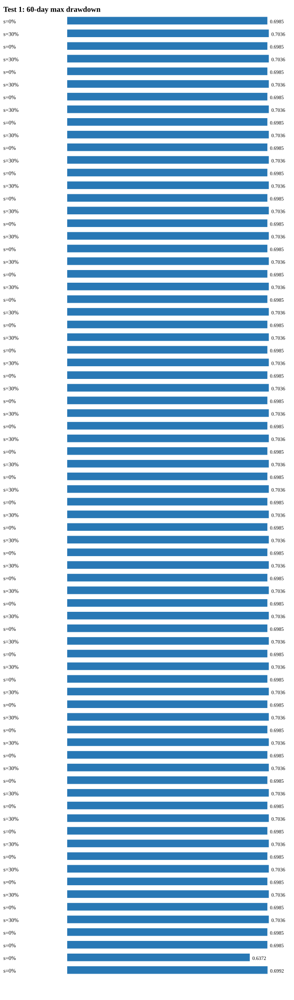
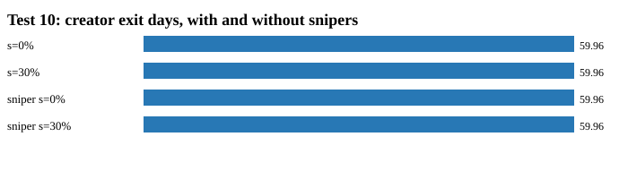

# Findings

These results describe a fixed public-chain replay and a synthetic rule
simulation. They do not describe all NEAR launches, predict a token's outcome,
or establish that the rules make a coin safe.

## Public launch replay

The replay selected the first 10 Nearly and first 5 JustHoot launches, in
descending creation order, that were at least 24 hours old at
2026-11-12 15:09:05.054 UTC. It used signed launch transactions as the launch
anchor and committed the public API, transaction-index, and archival-RPC
responses as fixtures. The selection had no outcome or volume filter. See the
[coin list](near-replay/results/coin-list.csv) and [replay method](near-replay/METHOD.md).

At N=17 blocks, the 15-coin cohort had 181.8 million observed pool-buy tokens
in total, averaging 1.21% of each coin's supply. This is pool-trade activity;
it does not include all token transfers or prove each buyer's later balance.
The values come from [measure 1](near-replay/results/measure-1-early-supply.csv).

For N=17, T=2% and the first hour, 7 of 15 coin rows have `UNKNOWN` seller
shares because at least one sell has no proven owner. In goblin, 23.04 million
sold tokens have no known owner, while known-owner net pool sells total 2.74
million tokens. The share columns are `UNKNOWN`; there is no verified link from
those unowned sells to goblin's creator in the reviewed chain records. This
does not identify who controls or funded those accounts, or where the tokens
went. See [measure 2](near-replay/results/measure-2-who-sold.csv); the replay
method describes ownership limits.

## Sell-rule simulation

The checkpoint runs tests 1 and 4 for N=17, T=2%, brake off, a 10% band
penalty, a one-hour window, and creator fee shares of 0% and 30%. In the
seed-7, 60-day synthetic activity path, maximum drawdown is 69.85% at s=0% and
70.36% at s=30%. These are scenario outputs, not observed market returns or a
forecast. Source: [checkpoint test 1](simulation/results/checkpoint/test-1.csv)
and [simulation method](simulation/METHOD.md).

In test 10, a simulated creator starting with 40 million tokens is still not
out by day 60: 1.78 million remain at s=0%, and 4.11 million remain with the
simulated sniper-buy pattern. This tests one scripted path; it does not estimate
how long a real creator or most wallets would take to sell. Source:
[test 10 results](simulation/results/test-10.csv).

The rc.5 comparison vector for a band seller who buys and sells in the same
hour fills 11,910,132 tokens before the cap holds the rest (`cap_full`). It is a
rule-check case, not a launch observation. Its start state, rules, ordered
actions, and outcomes are in [cap-cases.json](simulation/results/cap-cases.json).

## Charts



*The chart compares 60-day maximum drawdown across the synthetic parameter settings.*



*Every plotted path remains short of a complete exit by the 60-day horizon.*

## Reproduce

From the repository root, replay the pinned 15-coin cohort and regenerate the
full simulation tables and committed charts with:

```sh
python3 analysis/near-replay/replay.py --as-of-ms 1794496145054
python3 analysis/simulation/simulate.py --checkpoint
python3 analysis/simulation/simulate.py
python3 analysis/simulation/charts.py
```

The replay reads committed fixtures for the fixed cohort. The simulation is a
deterministic synthetic model; its assumptions and outputs are documented in
`analysis/simulation/METHOD.md`.
