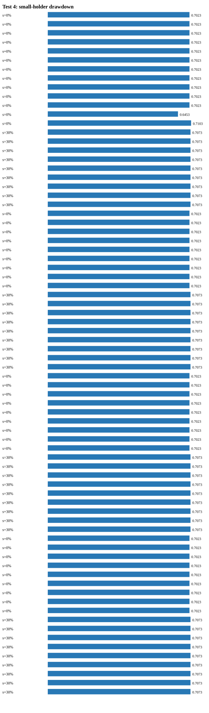

# Findings

This is a fixed public-chain replay and a synthetic rule simulation. It does
not cover every NEAR launch, predict a coin's outcome, establish that the rules
make a coin safe, or provide buy or sell advice.

## Public-chain replay

The replay selected the first 10 Nearly and first 5 JustHoot launches in
descending creation order that were at least 24 hours old at
2026-11-12 15:09:05.054 UTC. Selection had no outcome or volume filter. The
launch anchor is each coin's signed launch transaction; the committed fixtures
contain the public API, transaction-index, and archival-RPC responses. See the
[coin list](near-replay/results/coin-list.csv) and [replay method](near-replay/METHOD.md).

At N=17 blocks, the 15-coin cohort recorded 181.80 million pool-buy tokens,
with a mean per-coin share of 1.212% of supply. This measures observed pool
buys during those blocks; it excludes other token transfers and does not
establish what buyers later held. Source: [measure
1](near-replay/results/measure-1-early-supply.csv).

At N=17, T=2%, during the first hour, 7 of 15 coin rows have `UNKNOWN` seller
shares because at least one sell has no proven owner. For goblin, the replay
records 23.04 million sold tokens without a known owner and 2.74 million
known-owner net pool-sell tokens. The share columns are `UNKNOWN`: there is no
verified link from the unattributed sells to goblin's creator. This does not
show who controlled or funded those accounts, or where the tokens went. Source:
[measure 2](near-replay/results/measure-2-who-sold.csv); ownership limits are
documented in the [replay method](near-replay/METHOD.md).

## Sell-rule simulation

For N=17, T=2%, brake off, 10% band penalty, one-hour windows, and creator fee
shares of 0% and 30%, the seed-7, 60-day synthetic activity path gives test 1
maximum drawdowns of 69.85% and 70.36%, respectively. These are outputs of that
scripted path, not observed returns or a forecast. Source: [checkpoint test
1](simulation/results/checkpoint/test-1.csv) and the
[simulation method](simulation/METHOD.md).

In test 10, the simulated creator starts with 40 million tokens and is still
not out by day 60: at a 0% creator fee share, 1.78 million remain in the
baseline path and 4.11 million in the scripted sniper-buy path. These are
results for one model setup; they do not estimate a real creator's exit time
or how long most wallets take to sell. Source: [test 10
results](simulation/results/test-10.csv).

In the rc.7 `band-above-allowance-cap-left` rule-check case, a 30-million-token
band holder fills 11,247,222.281 tokens before the cap holds the rest. The
counted payout is 0.138357 NEAR; `cap_left` before the sell is 0.190476 NEAR.
The penalty makes this fill smaller than the no-penalty limit. This is a
synthetic rule check, not a launch observation. Source and ordered actions:
[cap-cases.json](simulation/results/cap-cases.json).

## Charts


*Test 1 compares 60-day maximum drawdown across the synthetic parameter settings.*



*Test 4 compares small-holder drawdown across the synthetic parameter settings.*


*Every plotted test 10 path still has creator tokens after the 60-day horizon.*

## Reproduce

Run these commands from the repository root. Replay uses the committed fixtures
for the pinned 15-coin cohort; the simulation uses a deterministic synthetic
model. The full simulation command also regenerates `cap-cases.json`.

```sh
python3 analysis/near-replay/replay.py --as-of-ms 1794496145054
python3 analysis/simulation/simulate.py --checkpoint
python3 analysis/simulation/simulate.py
python3 analysis/simulation/simulate.py --cap-cases
python3 analysis/simulation/charts.py
```
